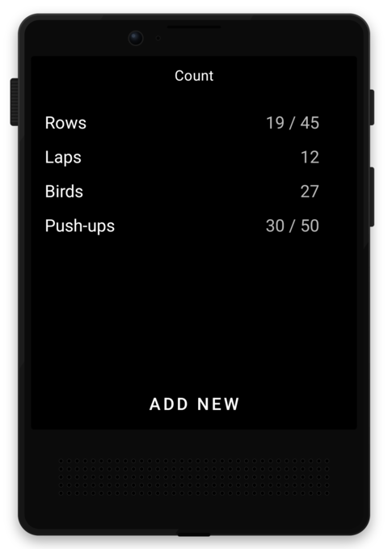
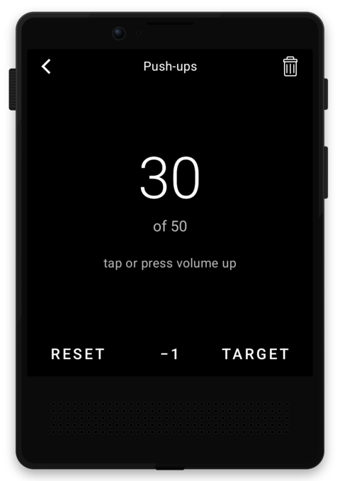
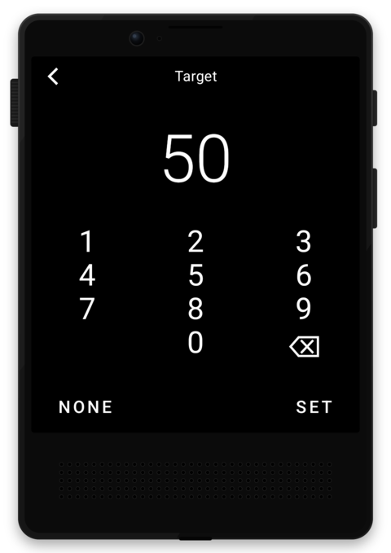

# Count

A tally counter for the Light Phone III: knitting rows, laps, birds, people through a door, anything you'd otherwise count on your fingers.

<p align="center">
  
  
  
</p>

- Keep several named counters. The list shows where each one stands.
- Tap anywhere on the screen, press volume up or the camera button to count. Volume down or **−1** takes one off. On the phone the scroll wheel counts too, so you can count without looking.
- Set a target with **TARGET** on a number pad. The counter shows "of 50" and the phone gives a distinct vibration when you reach it. **NONE** removes the target.
- **RESET** asks once more (**SURE?**) before going back to zero. The bin deletes the counter.

## Privacy

No account, no tracking, no analytics, no ads, and no network access. The only permission is vibration. Your counters stay on the phone.

## License

MIT, see `LICENSE`.

## Build

This repo holds only the `tool/` module. Copy it into a checkout of [light-sdk](https://github.com/lightphone/light-sdk), replacing its `tool/`, then:

```sh
./gradlew :tool:testDebugUnitTest :tool:assembleRelease
```
